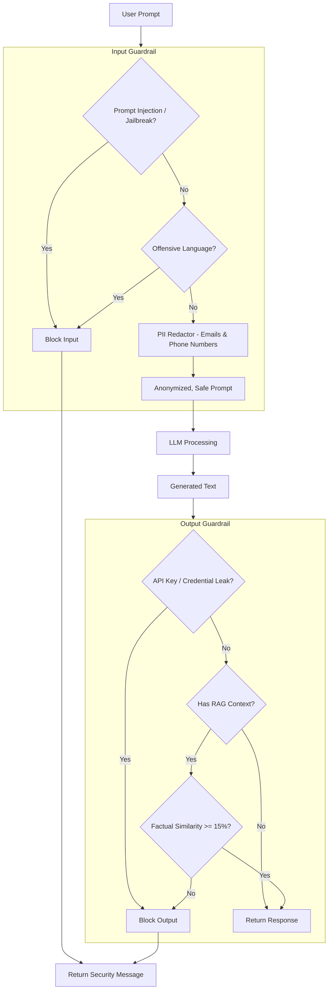

# LLM Guardrails Shield

Modular bidirectional security firewall (Guardrails) designed to intercept, evaluate, and mitigate operational risks in interactions with language models (LLMs), on both input (user prompts) and output (model generations).

This system ensures compliance with privacy policies, prevents cyberattacks aimed at bypassing guidelines (jailbreaks), and safeguards the accuracy of information returned by the LLM in Retrieval-Augmented Generation (RAG) architectures, blocking hallucinations and accidental secret leaks.

## Bidirectional Evaluation Architecture

The firewall operates synchronously in the data pipeline through two independent layers of automatic inspection.



### 1. Input Guardrail (Input Safeguards)

Before the query is sent to the LLM or the router, the prompt is analyzed by the following heuristic filters:

*   **Prompt Injection and Jailbreak Detection:** Scans the text against compiled regular-expression patterns looking for signatures of classic attacks, system-prompt overrides (e.g. `"ignore all previous instructions"`), calls to DAN mode (`"DAN mode"`), or direct system-prompt override commands `[system: override]`.
*   **Offensive Language Filter:** Looks for explicit word-boundary matches (`\b{term}\b`) against a customizable list of toxic words in Spanish, preventing abuse in conversational interfaces.
*   **Personally Identifiable Information (PII) Redaction:** Anonymizes sensitive data by replacing it with placeholders (`[EMAIL]` and `[PHONE]`) to prevent inadvertent exposure of data to external APIs.
    *   *Email regex:* `\b[A-Za-z0-9._%+-]+@[A-Za-z0-9.-]+\.[A-Z|a-z]{2,7}\b`
    *   *Phone regex:* `\b(?:\+?\d{1,3}[-.\s]?)?\(?\d{2,3}\)?[-.\s]?\d{3}[-.\s]?\d{3,4}\b` (designed to capture Spanish phone formats with or without an international prefix and spacing/hyphen intervals).

### 2. Output Guardrail (Output Safeguards)

Once the model returns a response, it goes through strict security checks before being served to the client:

*   **Secret Leakage Prevention (Secret Leakage Block):** Identifies security expressions such as OpenAI authentication tokens (`sk-...`), Google console credentials (`AIzaSy...`), or general configuration-variable storage patterns (`password=...`, `apikey=...`). If a match is found, delivery is blocked to prevent infrastructure compromise.
*   **Hallucination and Factual Consistency Control (Fact-Checking RAG):** Validates the response's alignment with the documents that served as search context.
    1.  Sets of unique words with length greater than or equal to 4 characters are extracted from the generation ($V_{\text{gen}}$) and from the supplied RAG context ($V_{\text{ctx}}$).
    2.  The factual consistency index is computed:
        $$R = \frac{|V_{\text{gen}} \cap V_{\text{ctx}}|}{|V_{\text{gen}}|}$$
    3.  If $R < 0.15$ (fewer than 15% of the concepts in the response are backed by the RAG source documents), the model is assumed to have hallucinated or introduced false data, and the output is immediately blocked.

## Connection to the Ecosystem

This shield integrates across the ecosystem as follows:
1.  **hybrid-search-retrieval-pipeline:** Supplies the factual context (documents retrieved from NanoVectorDB and BM25) to feed the output validator and check the hallucination rate.
2.  **orchestra-agents / secure-tool-runtime:** Agent input prompts and the results returned by console tool executions pass through this filter beforehand, to guarantee there are no privilege-escalation attempts or offenses in the ReAct cycle.

## Project Structure

*   `shield.py`: Implementation of the `LLMGuardrailsShield` class with the PII, injection, toxicity, and fact-checking methods.
*   `test_shield.py`: Unit test suite that thoroughly verifies validations under edge cases (covert injections, complex phone numbers, controlled hallucination, and sk-key leaks).
*   `example.py`: Interactive demo script that runs offensive test flows, RAG injections, and leaks, showing what goes in, what comes out, and the firewall's detailed reasons for intervening.

## Using it as a package

Since `0.1.0` the code lives in the `llm_guardrails_shield` package and the repository is
pip-installable, so other projects can depend on it instead of copying files
or editing `sys.path`:

```bash
pip install "llm-guardrails-shield @ git+https://github.com/juanmmm21/llm-guardrails-shield.git@v0.1.0"
```

```python
from llm_guardrails_shield import LLMGuardrailsShield
```

The old top-level modules are kept as thin re-exports, so scripts that add
this folder to `sys.path` keep working. This component imports no other
ai-core component: they are combined in the `aicore` SDK of
[ai-core-infra-hub](https://github.com/juanmmm21/ai-core-infra-hub), which
passes collaborators (vector stores, encoders, tokenizers) in by injection.

Development: `pip install -e ".[dev]"`, then `pytest` and `ruff check .`.

## Installation and Usage

### 1. Activate the Local Environment and Install Dependencies

Since the module uses native regular expressions and lightweight validation structures, it requires no hardware acceleration:

```bash
python3 -m venv .venv
source .venv/bin/activate
pip install -r requirements.txt
```

### 2. Run Automated Security Tests

The test suite validates the PII filtering, injection, and factual consistency policies:

```bash
.venv/bin/python -m unittest test_shield.py
```

### 3. Run the Firewall Demo

```bash
.venv/bin/python example.py
```

The script simulates real-time attacks and situations, illustrating how the firewall purifies a prompt before inference and restricts the return of responses when it detects exposed secrets or RAG hallucinations.
